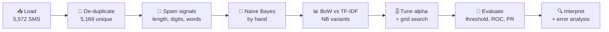
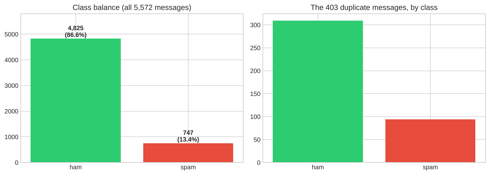
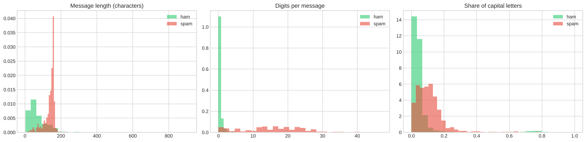
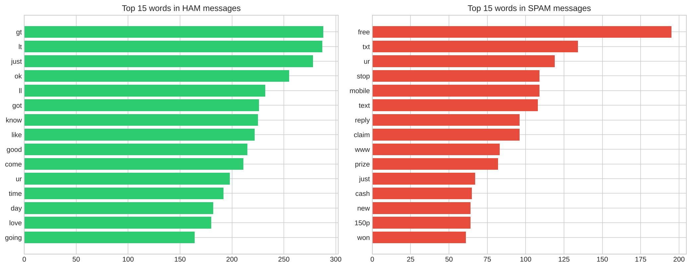
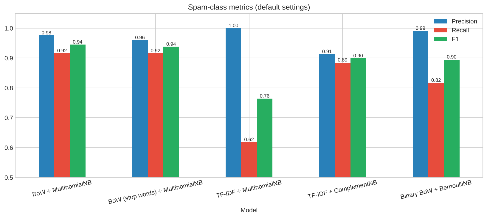
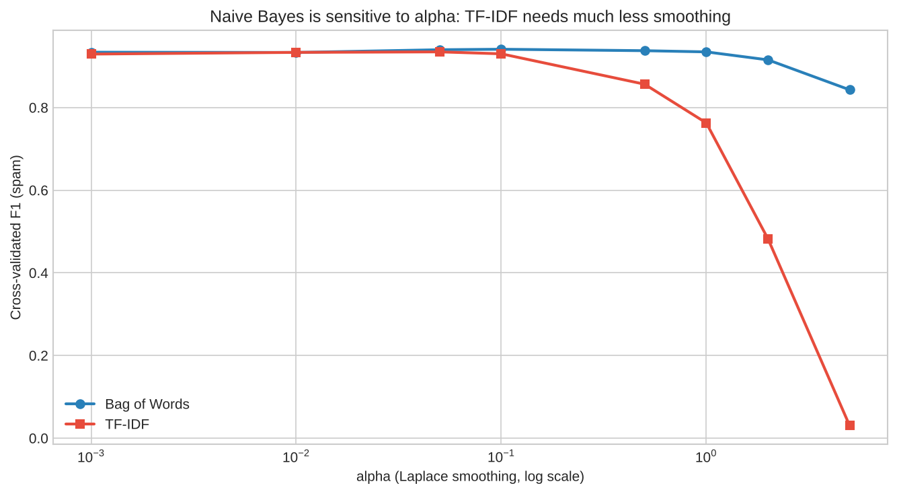
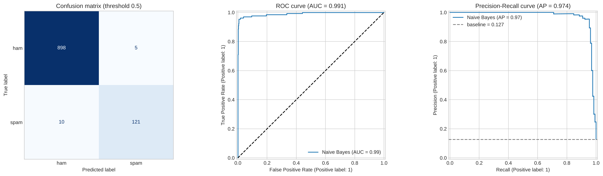
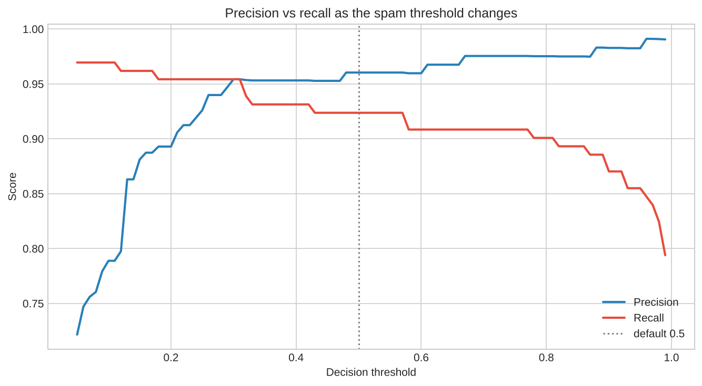
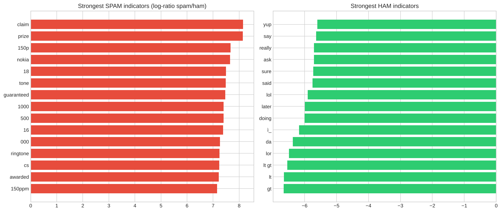
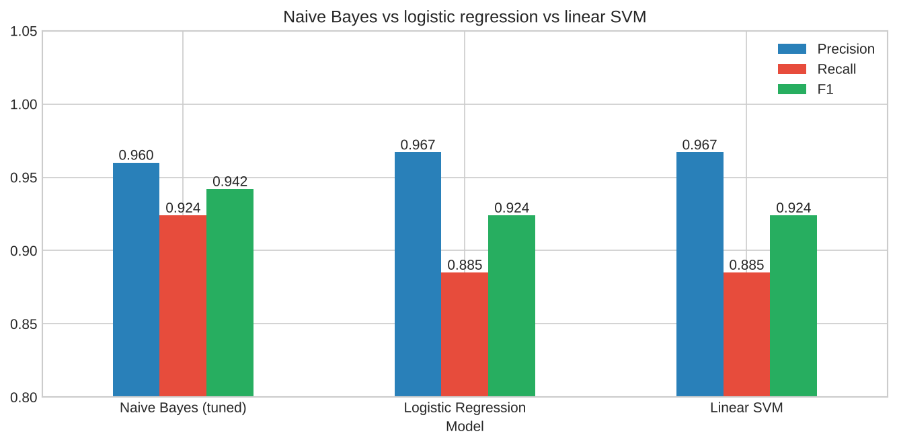

<div align="center">

# 📩 SMS Spam Detection with Naive Bayes

### Text classification from raw messages: TF-IDF, Bayes' theorem, Laplace smoothing, tuning and error analysis

[](https://spam-detection-naive-bayes-027.streamlit.app/)


</div>

---

## 🎯 Objective
Implement and understand the **Naive Bayes** classifier by detecting spam text messages: turn text into numbers, see exactly how Bayes' theorem produces a prediction, tune the smoothing parameter and judge the model with the right metrics.

**Dataset:** SMS Spam Collection, **5,572 real text messages**: 4,825 ham (86.6%) and 747 spam (13.4%). After removing **403 exact duplicates**: 5,169 unique messages (653 spam, 12.6%), split into **4,135 train / 1,034 test** (stratified).

## ⚡ Highlights

| | |
|---|---|
| 🧮 **Naive Bayes by hand** | Posterior computed manually for a real message and **identical to scikit-learn's** output |
| 🧹 **Data leakage avoided** | 129 of 1,115 test messages would have also been in training without de-duplication |
| ⚠️ **Default TF-IDF fails** | `alpha = 1` misses 38% of spam (recall **0.618**, F1 0.764) |
| 🔧 **After tuning** | Word pairs + `alpha = 0.01`: F1 **0.942** |
| 🎯 **Final test results** | Accuracy **0.9855**, precision **0.960**, recall **0.924**, ROC-AUC **0.991** |
| 🏆 **Vs other models** | Beats logistic regression and linear SVM (F1 0.924) and trains fastest |

## 🔄 Pipeline



## 📂 Project Structure

```
spam-detection-naive-bayes/
├── 📁 data/
│   └── spam.csv                    # SMS Spam Collection (5,572 messages)
├── 📁 images/                      # 9 plots generated by the notebook
├── 📓 naive_bayes_spam.ipynb       # full notebook with outputs
├── 📄 requirements.txt
└── 📄 README.md
```

## 🧹 Data Hygiene & Spam Signals


**403 messages are exact duplicates** (spammers re-send the same text). They were removed **before** splitting, otherwise the model is partly graded on messages it has already seen (**129 of 1,115** test messages would have leaked).



| Signal | Ham | Spam |
|---|---|---|
| Mean length (characters) | 70.5 | **137.9** |
| Digits per message | 0.29 | **15.4** |
| Share of capital letters | 5.7% | **11.0%** |



## 🧮 How Naive Bayes Works
**P(spam | words) ∝ P(spam) × P(w₁ | spam) × … × P(wₙ | spam)**, computed in **log space**. The "naive" part is the assumption that words are independent given the class; **Laplace smoothing** (`alpha`) stops unseen words from forcing a probability to 0.

The notebook computes this **by hand** for a real message (prior + the sum of per-word log-ratios) and shows that the result is **identical to `predict_proba`** from scikit-learn: Naive Bayes is just counting words and adding logarithms.

## 📊 Text Representations & Variants


| Model (default settings) | Precision | Recall | F1 |
|---|---|---|---|
| **BoW + MultinomialNB** | 0.976 | 0.916 | **0.945** |
| BoW (stop words) + MultinomialNB | 0.960 | 0.916 | 0.938 |
| TF-IDF + MultinomialNB | 1.000 | **0.618** | 0.764 |
| TF-IDF + ComplementNB | 0.913 | 0.885 | 0.899 |
| Binary BoW + BernoulliNB | 0.991 | 0.817 | 0.895 |

TF-IDF with default settings has perfect precision but **misses 38% of spam**: TF-IDF values are tiny, so the default `alpha = 1` smoothing flattens the differences between words.

## 🎚️ Smoothing (`alpha`) Matters


| alpha | 0.001 | 0.01 | 0.05 | 0.1 | 0.5 | 1 | 2 | 5 |
|---|---|---|---|---|---|---|---|---|
| Bag of Words (CV F1) | 0.934 | 0.933 | 0.940 | 0.941 | 0.937 | 0.935 | 0.915 | 0.843 |
| TF-IDF (CV F1) | 0.929 | 0.933 | 0.935 | 0.930 | 0.856 | 0.763 | 0.482 | 0.030 |

Bag of Words is forgiving, TF-IDF **collapses** at the default. `alpha` must be tuned together with the representation.

**GridSearchCV** (80 combinations, 5-fold, scored on F1): TF-IDF with **1 to 2-grams**, English stop words removed, `alpha = 0.01` → CV F1 **0.9420** (vocabulary of 30,960 terms).

## 🎯 Final Evaluation


| Metric | Value |
|---|---|
| Accuracy | 0.9855 |
| Precision (spam) | 0.960 |
| Recall (spam) | 0.924 |
| F1 (spam) | 0.942 |
| ROC-AUC / PR-AUC | 0.991 / 0.975 |

Confusion matrix (1,034 test messages): **898 ham correct · 5 ham flagged as spam · 10 spam missed · 121 spam caught**. An "always ham" model would be 87.3% accurate and catch **zero** spam, so accuracy alone is misleading.

## ⚖️ The Decision Threshold


| Threshold | Precision | Recall | Ham flagged as spam | Spam missed |
|---|---|---|---|---|
| 0.3 | 0.954 | 0.954 | 6 | 6 |
| **0.5 (default)** | 0.960 | 0.924 | 5 | 10 |
| 0.7 | 0.975 | 0.908 | 3 | 12 |
| 0.9 | 0.983 | 0.870 | 2 | 17 |
| 0.95 | 0.982 | 0.855 | 2 | 19 |

Raising the threshold trades **recall for precision**; the right value depends on how costly a false alarm is compared with a missed spam.

## 🔍 Interpretation & Error Analysis


- **Spam indicators:** *claim, prize, 150p, nokia, 18, tone, guaranteed, 1000, 500, ringtone*
- **Ham indicators:** chatty words (*lor, da, doing, later, lol, said, sure, ask*) plus data quirks such as `gt` / `lt` (from "&gt;" / "&lt;") and `ì_` (an encoding artefact)
- **10 missed spam:** adult chat-line / dating ads, promotions, quiz and news services, a missed-call alert: spam that avoids the usual vocabulary
- **5 false alarms:** short slang texts with spam-flavoured tokens (*"YO YO YO BYATCH WHASSUP?"*, *"K:)eng rocking in ashes:)"*, *"Nokia phone is lovly.."*): *nokia* is judged "spam" on its own, a classic Naive Bayes side-effect

## ⚖️ Comparison with Other Text Classifiers


| Model (TF-IDF 1 to 2-grams, tuned) | Precision | Recall | F1 | Accuracy |
|---|---|---|---|---|
| **Naive Bayes** | 0.960 | **0.924** | **0.942** | **0.985** |
| Linear SVM | 0.967 | 0.885 | 0.924 | 0.982 |
| Logistic Regression | 0.967 | 0.885 | 0.924 | 0.982 |

Naive Bayes catches 5 more spam messages (121 vs 116) at the cost of one more false alarm, and it is the **fastest to train** because it only counts words.

## 🌐 Live App
An interactive Streamlit app (`app.py`) lets you paste any SMS and see the verdict, the spam probability, and the exact words that drove it. It also supports batch checking (paste or CSV upload with download), an adjustable spam threshold, and live test-set metrics (confusion matrix, ROC / PR curves, threshold trade-off).

```bash
pip install -r requirements.txt
streamlit run app.py
```

## ▶️ How to Run
```bash
git clone https://github.com/D0027/spam-detection-naive-bayes.git
cd spam-detection-naive-bayes
pip install -r requirements.txt
jupyter notebook naive_bayes_spam.ipynb
```
Also runs on Kaggle: add the *SMS Spam Collection* dataset via **+ Add Input** and click **Run All**.

## 🎤 Interview Questions

<details>
<summary><b>1. What is Bayes' theorem and how does Naive Bayes use it?</b></summary>

P(class | features) = P(features | class) · P(class) / P(features). Naive Bayes picks the class with the largest numerator: the class prior times the likelihood of the observed features.
</details>

<details>
<summary><b>2. Why is it called "naive"?</b></summary>

It assumes all features (words) are **conditionally independent** given the class, so the joint likelihood becomes a simple product of per-word probabilities. This is rarely true in language, yet the classification is often still accurate.
</details>

<details>
<summary><b>3. What is Laplace smoothing and why is it needed?</b></summary>

Adding `alpha` to every word count avoids zero probabilities for words never seen in a class (which would wipe out the whole product). Larger `alpha` means more smoothing; it must be tuned (here 0.01 to 0.05 for TF-IDF).
</details>

<details>
<summary><b>4. Multinomial vs Bernoulli vs Gaussian Naive Bayes?</b></summary>

Multinomial: word counts / frequencies (text). Bernoulli: binary presence/absence of words. Gaussian: continuous features assumed normally distributed within each class. Complement NB is a variant suited to imbalanced text.
</details>

<details>
<summary><b>5. Bag of Words vs TF-IDF?</b></summary>

BoW counts words; TF-IDF down-weights words common to many documents and normalises length. They change the feature scale, which is why the best `alpha` differs (BoW is fine anywhere from 0.1 to 1, TF-IDF needs about 0.01 to 0.05).
</details>

<details>
<summary><b>6. Why do we use log probabilities?</b></summary>

Multiplying hundreds of small probabilities underflows to 0; summing their logs is stable and gives the same ranking of classes.
</details>

<details>
<summary><b>7. Why is Naive Bayes good for text?</b></summary>

Very high-dimensional sparse features, fast to train (just counting), works with small datasets, robust, and its predictions are interpretable.
</details>

<details>
<summary><b>8. Why is accuracy a bad metric for spam detection?</b></summary>

With 12.6% spam, always predicting "ham" is 87.4% accurate. Use precision, recall, F1 and PR-AUC, and choose the threshold according to the cost of false positives vs false negatives.
</details>

<details>
<summary><b>9. What is data leakage and where did it show up here?</b></summary>

Information from the test set leaking into training. Exact duplicate messages (403) appeared in both splits (129 of 1,115 test messages), so we de-duplicated first.
</details>

<details>
<summary><b>10. What are the limitations of Naive Bayes?</b></summary>

The independence assumption ignores word order and context, probabilities are often poorly calibrated (overconfident), and it cannot learn feature interactions, so stronger models (linear SVM, boosting, transformers) can outperform it.
</details>

<details>
<summary><b>11. How would you improve this spam filter?</b></summary>

Add engineered features (digit count, URL / phone-number patterns, length, capitals), use character n-grams, combine with a linear model, and retrain regularly because spam keeps changing.
</details>

## 👤 Author

**Deepak Yadav**

[](https://github.com/D0027)
[](https://linkedin.com/in/deepakyadav027)
[](https://d0027.github.io)
